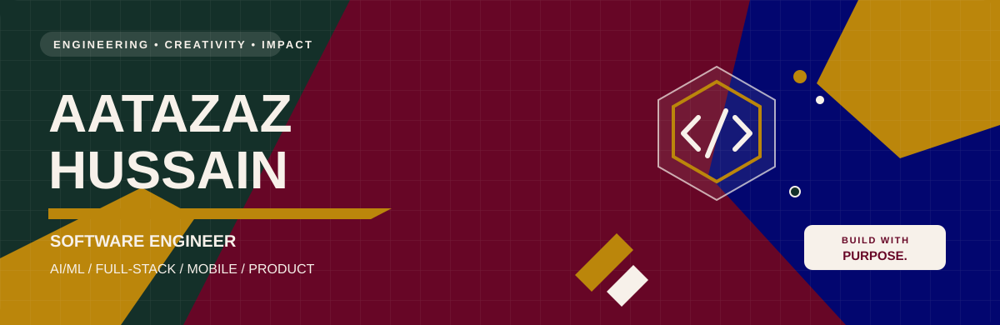
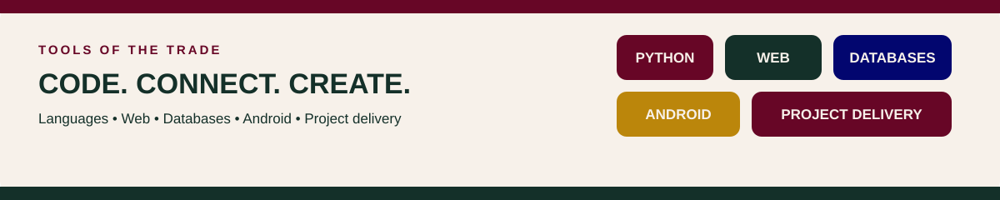

### Software Engineer · AI/ML Enthusiast · Full-Stack & Mobile Developer · Project Manager

**I build at the intersection of AI, software, and product.**

---

## ◈ ABOUT ME

I'm a Software Engineer with a diverse technical background spanning **AI/ML, software development, modern web and mobile applications, databases, backend systems, and project management**.

I enjoy working across the development lifecycle — from understanding a problem and designing a solution to building, testing, coordinating, and continuously improving it.

> **MY GOAL** — Solve complex problems with clean engineering, useful technology, and thoughtful execution.

## ◈ WHAT I DO

<table>
<tr>
<td width="50%" valign="top">

### ◈ AI & Machine Learning
Exploring intelligent systems and practical AI/ML applications.

</td>
<td width="50%" valign="top">

### ◈ Software Engineering
Designing and developing reliable software solutions.

</td>
</tr>
<tr>
<td width="50%" valign="top">

### ◈ Web Development
Building modern frontend and backend applications.

</td>
<td width="50%" valign="top">

### ◈ Mobile Development
Developing Android applications with Java and Kotlin.

</td>
</tr>
<tr>
<td width="50%" valign="top">

### ◈ Database & Backend
Working with relational and NoSQL databases, APIs, services, and custom server solutions.

</td>
<td width="50%" valign="top">

### ◈ Project Management
Planning, organizing, tracking, and delivering software projects.

</td>
</tr>
</table>

---

## ◈ TECH STACK

### Programming Languages
`Python` · `C++` · `C#` · `C` · `Java` · `Kotlin`

### Web & Backend Development
`HTML5` · `CSS3` · `JavaScript` · `Node.js`

**Areas of interest:** `Frontend Development` · `Backend Development` · `REST APIs` · `Server Development` · `Web Applications` · `Custom Server Architecture`

### Databases
`MySQL` · `SQLite` · `PostgreSQL` · `MongoDB`

I work with both **relational and NoSQL databases**, depending on application requirements, data structure, scalability, and performance needs.

### Mobile Development
`Java` · `Kotlin` · `Android`

I build Android applications with a focus on **functionality, performance, maintainability, and user experience**.

---

## ◈ PROJECT MANAGEMENT

I also work across the **project management and software delivery** side of development.

**TOOLS I USE**

`ClickUp` · `Trello` · `Asana` · `Jira` · `Microsoft Project` · `Redmine`

**PROJECT MANAGEMENT AREAS**

| Planning & Coordination | Delivery & Improvement |
|:--|:--|
| Project planning | Agile workflows |
| Task and milestone management | Issue and bug tracking |
| Team coordination | Time and resource management |
| Progress monitoring | Software delivery |

---

## ◈ CURRENTLY EXPLORING

| ARTIFICIAL INTELLIGENCE | MACHINE LEARNING | INTELLIGENT APPLICATIONS |
|:---:|:---:|:---:|
| SCALABLE BACKEND SYSTEMS | SOFTWARE ARCHITECTURE | AUTOMATION |
| MODERN WEB TECHNOLOGIES | MOBILE APPLICATION DEVELOPMENT | CONTINUOUS LEARNING |

---

## ◈ GITHUB AT A GLANCE

---

## ◈ MY ENGINEERING PHILOSOPHY

### Learn continuously. Build intentionally. Solve problems practically.

I believe good software isn't just about writing code.

It's about understanding the **problem**, designing the right **solution**, choosing appropriate **technology**, building something **maintainable**, and delivering something that creates **real value**.

## ◈ WHAT YOU'LL FIND HERE

My GitHub is where I experiment, build, learn, and share.

- AI and Machine Learning
- Web Applications
- Backend and Server Development
- Android Applications
- Database-driven Systems
- Experiments and Research
- Developer Tools
- Personal and Open-Source Projects

---

**CHERRY · WARM IVORY · AMBER · EMERALD · ROYAL BLUE**

*Code · Learn · Build · Improve · Repeat*

"# aatazaz-hussain" 
